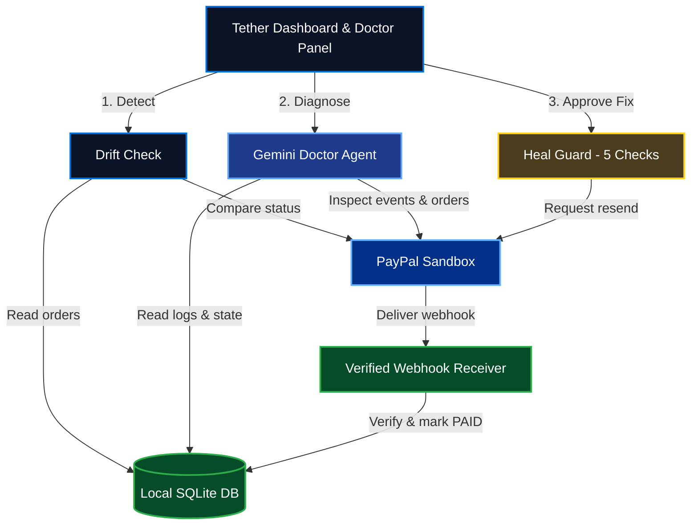

<div align="center">

# Tether

**The PayPal webhook doctor: finds paid orders your system never heard about, explains why, and heals them safely.**

[](https://nextjs.org/)
[](https://www.typescriptlang.org/)
[](https://developer.paypal.com/api/rest/)
[](https://ai.google.dev/)
[](https://www.ag-grid.com/studio/)
[](https://render.com/)
[](LICENSE)

[**Live demo**](https://tether-z96s.onrender.com) · [**Demo video**]([VIDEO_URL])

</div>


## The problem

PayPal retries a webhook only when the listener visibly fails the request. If your listener answers `HTTP 200` and then loses the event — during a deploy, a queue hiccup, a swallowed exception, or a downstream DB timeout — PayPal marks the delivery complete and never retries. PayPal says the order is `COMPLETED`, while your local database stays stuck at `CREATED` with no error in any log. [PayPal retries non-2xx webhooks up to 25 times over 3 days](https://developer.paypal.com/api/rest/webhooks/), yet [73% of SME decision-makers call payment reconciliation a major frustration](https://ffnews.com/newsarticle/adyen-highlights-slow-cash-flow-and-payment-reconciliation-stalling-sme-growth-draining-time-and-resources/).

## What Tether does

1. **Detect** — Compares unpaid local orders in SQLite against live PayPal sandbox order statuses (`GET /v2/checkout/orders/{id}`) to spot silent state drift.
2. **Diagnose** — Runs a tool-calling Gemini Doctor Agent across webhook registrations, local receipt logs, PayPal event logs, and fault settings, streaming each step over Server-Sent Events (SSE).
3. **Guard** — Evaluates five server-side pre-conditions in [`lib/heal.ts`](lib/heal.ts) and recomputes `safe_to_heal` in code rather than trusting model output.
4. **Heal** — Requests an official PayPal webhook replay (`POST /v1/notifications/webhooks-events/{event_id}/resend`) after human approval, never editing the database directly.
5. **Prove** — Verifies the cryptographic signature on the re-delivered webhook (`POST /v1/notifications/verify-webhook-signature`), flips the order to `PAID`, and logs `seconds_to_fixed` in the audit trail.

## Try it in 60 seconds

> **Note:** Open the [**live demo**](https://tether-z96s.onrender.com). It is hosted on Render's free tier, so the instance may take up to a minute to wake on the first request.

1. **Create a drifting order (or pick an existing one):** Click **DEMO** in the top-right bar, turn **Simulate dropped webhooks** **ON**, click **Create sandbox order**, open **Approve in PayPal sandbox** to sign in as a buyer, click **Capture order**, and then turn **Simulate dropped webhooks** **OFF** so the listener can receive the replay.
2. **Open the Doctor panel:** Click the red **`N open`** drift pill in the top bar (or select the drifting row in the **Local orders** table) to open the **Doctor panel**.
3. **Investigate:** Click **Investigate** on the drifting order; watch live SSE step cards (`02-doctor.png`) stream in as Gemini calls its diagnostic tools and produces a root-cause card (`03-diagnosis.png`).
4. **Approve fix:** Click **Approve fix** in the Doctor panel footer to trigger a guarded PayPal webhook resend.
5. **See the proof:** Within seconds, PayPal resends `PAYMENT.CAPTURE.COMPLETED`, `/api/webhook` verifies its signature, the reconciliation strip and order status flip from `CREATED` to `PAID`, **Open drift** drops to `$0`, and the heal card records the exact **Seconds to fixed** (`04-healed.png`).

## How it works

### Architecture



### Guarded heal sequence

```mermaid
sequenceDiagram
  participant U as Operator
  participant A as Doctor Agent
  participant G as Heal Guard
  participant P as PayPal Sandbox
  participant D as Webhook & SQLite

  rect rgb(60, 20, 25)
    Note over P,D: 1. Drift — PayPal is COMPLETED, SQLite is still CREATED
  end

  rect rgb(20, 38, 75)
    U->>A: Click "Investigate"
    A->>P: Check order, event log & webhook URL
    A->>D: Check local receipts & 5 pre-conditions
    A-->>U: Diagnosis + safe_to_heal: true
  end

  rect rgb(15, 55, 35)
    U->>G: Click "Approve fix"
    G->>P: Verify 5 checks & resend webhook
    P->>D: Re-deliver PAYMENT.CAPTURE.COMPLETED
    D->>D: Verify signature & mark order PAID
    G-->>U: Healed + seconds_to_fixed
  end
```



## Safety by design

| Principle | How it is enforced in code |
|---|---|
| **AI investigates, code decides** | `runDoctorAgent` in [`lib/agent/run.ts`](lib/agent/run.ts) overwrites the model's `safe_to_heal` boolean with the server-computed result of `propose_heal(orderId)`. |
| **No direct DB edits during heal** | `healOrderDrift` in [`lib/heal.ts`](lib/heal.ts) never updates `local_orders`. It only asks PayPal to resend the webhook; only a signature-verified `PAYMENT.CAPTURE.COMPLETED` in [`app/api/webhook/route.ts`](app/api/webhook/route.ts) can mark an order `PAID`. |
| **Evidence validation** | Every item in `evidence[]` must cite a real `tool_call_id` from the current run's trace. If JSON parsing or `tool_call_id` validation fails, the response is rejected and retried once (`validateAgentFinalResult`). |
| **Never claim success without proof** | After calling PayPal's resend endpoint, `healOrderDrift` polls `local_orders` every `1s` for up to `30s`. If `local_status` does not flip to `PAID`, it returns `healed: false` (`resend requested, not confirmed`). |
| **Full audit trail** | Every agent run is saved to `agent_runs` (model, trace JSON, result JSON) and every heal attempt — whether `healed`, `refused`, `resend_failed`, or `error` — is recorded in `heal_log`. |

### Five heal pre-conditions (`lib/heal.ts`)

Both `checkHealPreconditions` (called by `propose_heal`) and `healOrderDrift` enforce these five checks before calling PayPal's resend endpoint:

1. **`paypal_order_completed`** — Live `GET /v2/checkout/orders/{orderId}` confirms the PayPal order exists and its `status` is `COMPLETED`.
2. **`no_local_capture_webhook`** — `hasCompletedCaptureWebhookForOrder(orderId)` confirms no `PAYMENT.CAPTURE.COMPLETED` event is already stored in local `webhook_events` for this order.
3. **`event_in_paypal_log`** — `GET /v1/notifications/webhooks-events` finds the matching `PAYMENT.CAPTURE.COMPLETED` event in PayPal's event log and extracts its `event_id`.
4. **`not_already_resent_or_on_cooldown`** — `getLastResendAttemptForEvent(eventId)` checks `heal_log` to ensure the event was not already healed and is not within the `60s` resend cooldown (`RESEND_COOLDOWN_MS = 60_000`).
5. **`drop_webhooks_disabled`** — `settings.drop_webhooks` in SQLite is `"false"`, preventing a resend while the demo fault switch is still dropping webhooks.

## How PayPal is used

All live calls target `https://api-m.sandbox.paypal.com` using plain `fetch`:

| Capability | Endpoint | Purpose |
|---|---|---|
| OAuth 2.0 authentication | `POST /v1/oauth2/token` | Exchanges `PAYPAL_CLIENT_ID` and `PAYPAL_SECRET` (`client_credentials`) for a bearer token. |
| Webhook signature verification | `POST /v1/notifications/verify-webhook-signature` | Verifies `paypal-transmission-sig`, cert URL, transmission ID, timestamp, and `PAYPAL_WEBHOOK_ID` in `/api/webhook`. |
| Order status & drift check | `GET /v2/checkout/orders/{id}` | Reads live order `status` and capture details in `lib/drift.ts`, `lib/heal.ts`, and `lib/agent/tools.ts`. |
| Demo order creation | `POST /v2/checkout/orders` | Creates a sandbox `CAPTURE` order in `/api/demo/orders` and records `CREATED` in `local_orders`. |
| Demo order capture | `POST /v2/checkout/orders/{id}/capture` | Captures an approved sandbox order in `/api/demo/orders/[id]/capture` without touching `local_orders`. |
| Webhook event log lookup | `GET /v1/notifications/webhooks-events` | Searches PayPal's event history by `transaction_id` or 7-day time window for `PAYMENT.CAPTURE.COMPLETED`. |
| Webhook registration check | `GET /v1/notifications/webhooks` | Lists registered webhook URLs and event subscriptions to check against `PUBLIC_BASE_URL`. |
| Guarded webhook replay | `POST /v1/notifications/webhooks-events/{event_id}/resend` | Requests PayPal to re-deliver the missed webhook event (scoped to `PAYPAL_WEBHOOK_ID` when set). |

## How AI is used

- **Models & configuration ([`lib/gemini.ts`](lib/gemini.ts)):** Calls Google's Gemini REST API (`v1beta/models/{model}:generateContent`) using `GEMINI_API_KEY`. Primary model defaults to `GEMINI_MODEL` (`gemini-3.6-flash` if unset) and falls back to `GEMINI_FALLBACK_MODEL` (`gemini-3.5-flash` if unset).
- **Loop & validation limits ([`lib/agent/run.ts`](lib/agent/run.ts)):** Runs up to `MAX_STEPS = 8` tool-calling steps per investigation. If the model hits 8 tool calls without a final answer, it makes one final JSON-only turn. If the output fails schema or `tool_call_id` citation checks, it is rejected and retried once.
- **Timeout & fallback behaviour ([`lib/gemini.ts`](lib/gemini.ts)):** Each Gemini HTTP call has a `30,000ms` timeout (`CALL_TIMEOUT_MS`). On a timeout (`AbortError` / `TimeoutError`) or HTTP `429`, `500`, or `503`, `generateGeminiTurn` automatically retries the turn once on `GEMINI_FALLBACK_MODEL`.
- **Root-cause categories (`VALID_ROOT_CAUSES`):**
  - `WEBHOOK_DROPPED_BY_LISTENER`
  - `WEBHOOK_URL_OR_EVENT_MISMATCH`
  - `SIGNATURE_VERIFICATION_FAILING`
  - `NO_DRIFT`
  - `UNKNOWN`

### Agent tools (`lib/agent/tools.ts`)

| Tool name | What it checks |
|---|---|
| `get_drift` | Compares unpaid `local_orders` (`local_status != 'PAID'`) against live PayPal order statuses (`GET /v2/checkout/orders/{id}`). |
| `get_paypal_order` | Fetches live PayPal order status, intent, amount, and captures for `orderId`, alongside the local SQLite row. |
| `get_receipt_log` | Queries local `webhook_events` in SQLite for `orderId`, including `event_type` and `verification_status`. |
| `get_paypal_event_log` | Queries PayPal's `GET /v1/notifications/webhooks-events` (page size 50) for events matching `orderId` or its capture IDs. |
| `check_webhook_registration` | Calls `GET /v1/notifications/webhooks` and checks whether a registered webhook matches `PUBLIC_BASE_URL` and subscribes to `PAYMENT.CAPTURE.COMPLETED` (or `*`). |
| `check_fault_switch` | Reads `settings.drop_webhooks` from SQLite to see if demo fault injection is currently active. |
| `propose_heal` | Runs all 5 pre-condition checks in `checkHealPreconditions(orderId)` without resending any webhook, returning per-check results and `safe_to_heal`. |

## Built with

| Technology | Role in Tether |
|---|---|
| **Next.js 16 & React 19 (TypeScript)** | App Router frontend, server-rendered live data snapshot (`getTetherData`), and REST/SSE API routes. |
| **PayPal Sandbox REST API** | OAuth2, Checkout Orders v2, Webhook Signature Verification, Webhooks Management, and Event Resend. |
| **Google Gemini API** | Function-calling diagnostic agent (`lib/gemini.ts`, `lib/agent/run.ts`) with automatic fallback model retry. |
| **AG Studio 3.0 & AG Grid 36.2** | Relational data model (`webhook_events`, `local_orders`, `heal_log`, `agent_runs`, `drift` joined on `order_id`), KPI expressions (`moneyAtRisk`, `verificationRate`, `openDriftCount`, `avgSecondsToFixed`), charts, and interactive grids. |
| **SQLite (`better-sqlite3`)** | WAL-mode local persistence (`data/tether.db`) for orders, verified webhook receipts, heal audit logs, and agent runs. |
| **Server-Sent Events (SSE)** | Streams live agent `step`, `result`, and `error` events from `POST /api/agent` to the Doctor panel. |
| **Render** | Cloud web service hosting for the [live demo](https://tether-z96s.onrender.com). |
| **Antigravity & Claude** | AI development assistance used during the hackathon. |

## Run it locally

### Prerequisites

- **Node.js** `^20` (see `@types/node` in [`package.json`](package.json))
- A **PayPal Sandbox REST application** ([PayPal Developer Dashboard](https://developer.paypal.com/dashboard/applications/sandbox))
- A **Google Gemini API key** ([Google AI Studio](https://aistudio.google.com/))

### Setup

```bash
git clone https://github.com/John-Paul2/Tether.git
cd Tether
npm install
cp .env.example .env.local
```

Fill in `.env.local`, then start the development server:

```bash
npm run dev
```

Open your local server URL (which redirects to `/dashboard`). Other scripts in `package.json`: `npm run build`, `npm run start`, and `npm run lint`.

<details>
<summary><strong>Environment variables (matches <code>.env.example</code>)</strong></summary>

| Variable | Required? | Description |
|---|---|---|
| `PAYPAL_CLIENT_ID` | Yes | PayPal sandbox REST app client ID. |
| `PAYPAL_SECRET` | Yes | PayPal sandbox REST app secret. |
| `PAYPAL_WEBHOOK_ID` | Yes | ID of the webhook registered in your PayPal sandbox app (used for signature verification and scoped resends). |
| `PUBLIC_BASE_URL` | Yes | Publicly reachable base URL for your app (single source for `/api/webhook`, `/return`, `/cancel`, and `check_webhook_registration`). |
| `DATABASE_PATH` | No | Path to SQLite database file (defaults to `./data/tether.db` locally; set to `/tmp/tether.db` on Render free plan). |
| `GEMINI_API_KEY` | Yes | Google Gemini API key for the Doctor Agent. |
| `GEMINI_MODEL` | No | Primary Gemini model ID (defaults to `gemini-3.6-flash` in `lib/gemini.ts`). |
| `GEMINI_FALLBACK_MODEL` | No | Fallback Gemini model ID used on timeout or 429/500/503 (defaults to `gemini-3.5-flash`). |
| `DEMO_TOKEN` | No | Optional shared secret required via `x-demo-token` header on demo/heal routes when set. |
| `AGENT_DAILY_CAP` | No | Global daily cap on real Gemini diagnostic runs (defaults to `300`). |
| `AG_STUDIO` | No | Optional AG Studio license key passed to `AgStudioProvider`. |

</details>

### Deploy to Render

This repository includes a [`render.yaml`](render.yaml) Blueprint configured for Render's **Free** web service plan (`runtime: node`, `region: ohio`, no persistent disk, `DATABASE_PATH=/tmp/tether.db`, `healthCheckPath: /api/health`). On every startup or cold boot, [`instrumentation.ts`](instrumentation.ts) and [`lib/db.ts`](lib/db.ts) initialize the schema, seed the 3 verified `PAID` sandbox orders from [`seed/demo-seed.json`](seed/demo-seed.json) if `local_orders` is empty, and pre-fetch the PayPal OAuth access token.

Set these environment variables in the Render Dashboard (**Environment** tab):

- `PAYPAL_CLIENT_ID` — PayPal sandbox REST client ID (`sync: false`)
- `PAYPAL_SECRET` — PayPal sandbox REST secret (`sync: false`)
- `PAYPAL_WEBHOOK_ID` — Webhook ID registered in PayPal for `<PUBLIC_BASE_URL>/api/webhook` (`sync: false`)
- `PUBLIC_BASE_URL` — Your Render service URL, e.g. `https://your-service.onrender.com` (`sync: false`)
- `GEMINI_API_KEY` — Google Gemini API key (`sync: false`)
- `GEMINI_MODEL` — Optional primary Gemini model (`sync: false`)
- `GEMINI_FALLBACK_MODEL` — Optional fallback Gemini model (`sync: false`)
- `DEMO_TOKEN` — Optional token protecting `/api/demo/*` and heal routes via `x-demo-token` (`sync: false`)
- `AG_STUDIO` — Optional AG Studio license key (`sync: false`)
- `DATABASE_PATH` — `/tmp/tether.db` (set in `render.yaml`)
- `AGENT_DAILY_CAP` — `300` (set in `render.yaml`)

### Expose the webhook and create a drifting order

1. In the **DEMO** menu in the top bar, click **Load a drifting order** to immediately stage a pre-captured sandbox order as `CREATED` locally without needing a PayPal buyer login, or click **Reset demo** to restore the seeded baseline.
2. For the full create/approve/capture flow, open **Advanced demo** inside **DEMO**:
   - Set `PUBLIC_BASE_URL` to your public HTTPS URL.
   - In the [PayPal Developer Dashboard](https://developer.paypal.com/dashboard/applications/sandbox), register `<PUBLIC_BASE_URL>/api/webhook` subscribed to `PAYMENT.CAPTURE.COMPLETED` and set `PAYPAL_WEBHOOK_ID`.
   - Enable **Simulate dropped webhooks**, click **Create sandbox order**, approve the order in the PayPal sandbox buyer window, click **Capture order**, and then turn **Simulate dropped webhooks** **OFF**.

## Tested scenarios

[`scripts/test-agent.ts`](scripts/test-agent.ts) runs three end-to-end diagnostic scenarios against real PayPal sandbox orders and restores database state when finished:

| Scenario | Setup in `scripts/test-agent.ts` | Expected `root_cause` | `safe_to_heal` |
|---|---|---|---|
| **(a) Dropped webhook** | Order `2JJ686322T369532X` (`COMPLETED` in PayPal) set to `CREATED` locally with its local `PAYMENT.CAPTURE.COMPLETED` row removed and `drop_webhooks = false`. | `WEBHOOK_DROPPED_BY_LISTENER` | `true` |
| **(b) No drift** | Order `8N99210137712282F` already `PAID` locally and `COMPLETED` in PayPal with `drop_webhooks = false`. | `NO_DRIFT` | `false` |
| **(c) Webhook URL mismatch** | `PUBLIC_BASE_URL` temporarily set to `https://mismatch-webhook-host.example.com` so `check_webhook_registration` detects a mismatch. | `WEBHOOK_URL_OR_EVENT_MISMATCH` | `false` |

Run the test suite with:

```bash
node --experimental-strip-types scripts/test-agent.ts
```

## Project structure

```text
app/api/health/route.ts                   # Lightweight GET /api/health returning { ok: true }
app/api/webhook/route.ts                  # Receives PayPal webhooks, verifies signatures, updates PAID status
app/api/drift/route.ts                    # GET endpoint returning live PayPal vs. SQLite drift items
app/api/events/route.ts                   # GET endpoint returning the latest 100 local webhook_events
app/api/heal/route.ts                     # POST endpoint running guarded webhook resend and 30s verification poll
app/api/heal/log/route.ts                 # GET endpoint returning the latest 50 heal_log audit rows
app/api/agent/route.ts                    # GET recent agent runs; POST streams live Doctor Agent SSE steps
app/api/agent/approve/route.ts            # POST human-approved heal endpoint used by the Doctor panel
app/api/demo/load-drift/route.ts          # POST resets a pre-captured order to CREATED locally for 1-click judge demo
app/api/demo/reset/route.ts               # POST resets shared SQLite state back to the 3 seeded PAID orders
app/api/demo/fault/route.ts               # GET/POST toggle for settings.drop_webhooks fault injection
app/api/demo/orders/route.ts              # POST creates a PayPal sandbox order and inserts local CREATED row
app/api/demo/orders/[id]/capture/route.ts # POST captures a PayPal sandbox order without updating local SQLite
app/return/page.tsx                       # PayPal buyer approval return page with link back to /dashboard
app/cancel/page.tsx                       # PayPal buyer cancel page with link back to /dashboard
app/dashboard/                            # AG Studio dashboard, TopBar, MoneyBox, ReconciliationStrip, DoctorPanel
instrumentation.ts                        # Boot hook initializing SQLite schema, seed, and PayPal OAuth token cache
lib/db.ts                                 # SQLite schema, seed loader, demo reset/load-drift, and queries
lib/protection.ts                         # x-demo-token verification, per-IP rate limiting, and AGENT_DAILY_CAP
lib/drift.ts                              # Read-only drift detector comparing unpaid local orders to PayPal
lib/heal.ts                               # Five pre-condition checks, PayPal webhook resend, and verification polling
lib/gemini.ts                             # Gemini REST client with function calling, 30s timeout, and fallback retry
lib/agent/tools.ts                        # Seven diagnostic tool declarations and implementations
lib/agent/run.ts                          # Doctor Agent loop, evidence validator, and server-side safe_to_heal override
lib/tether-data.ts                        # Server snapshot builder flattening SQLite and live drift for AG Studio
seed/demo-seed.json                       # Non-secret seed of 3 real PAID PayPal sandbox orders
render.yaml                               # Render Free plan Blueprint configuration
scripts/test-agent.ts                     # End-to-end verification script for Scenarios (a), (b), and (c)
DESIGN.md                                 # Design system tokens, typography, and component rules
```

## Limitations and roadmap

**Current limitations:**
- **Sandbox only:** Hardcoded to `https://api-m.sandbox.paypal.com`.
- **Human-in-the-loop required:** Every heal requires an operator to click **Approve fix** (or call `/api/heal` / `/api/agent/approve`).
- **Ephemeral SQLite on Render free tier:** Local SQLite state in `DATABASE_PATH` resets when a free Render instance spins down or redeploys, and automatically re-seeds from `seed/demo-seed.json` on boot.

**Roadmap (not built yet):**
- **Autopilot within policy:** Optional auto-heal when all 5 pre-conditions pass and confidence is `high`.
- **WooCommerce and Shopify adapters:** Plug-in connectors for merchant order tables beyond local SQLite.
- **Slack and email alerts:** Push notifications when `checkOrderDrift` detects money at risk.
- **Daily reconciliation sweep & more event types:** Scheduled background checks and support for refunds, disputes, and subscriptions.

## License

Released under the [MIT License](LICENSE).
